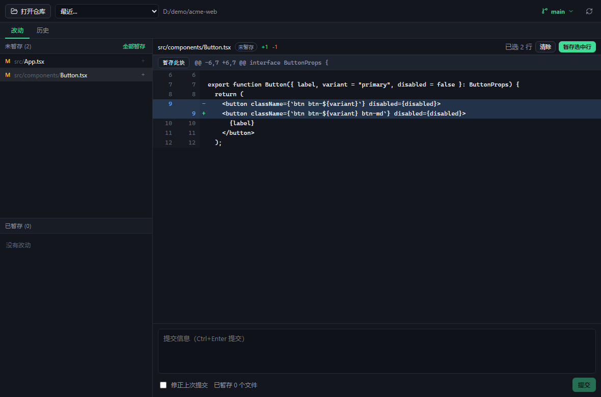
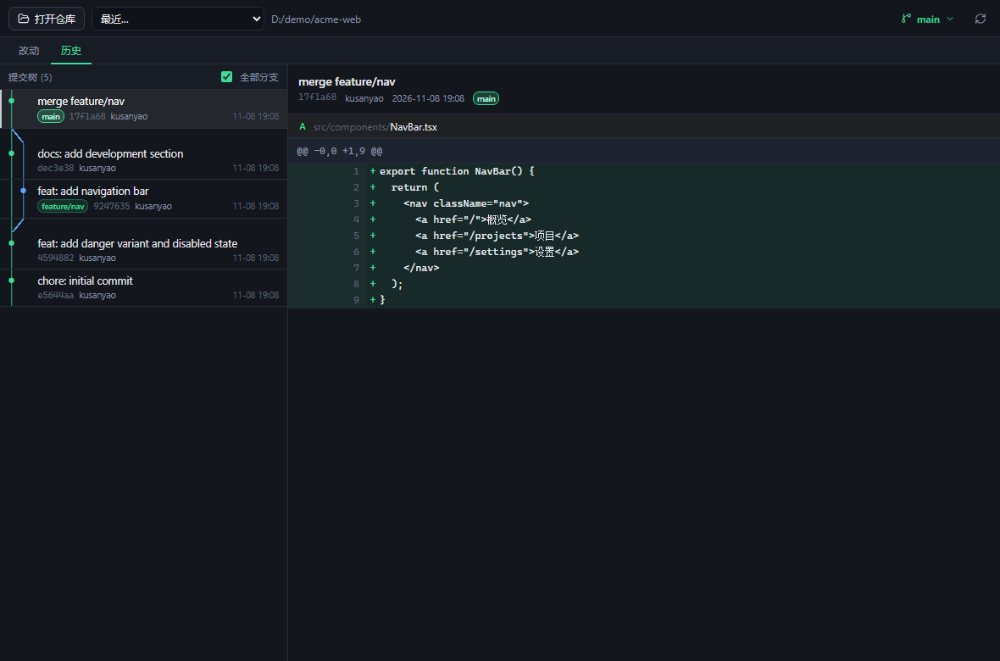
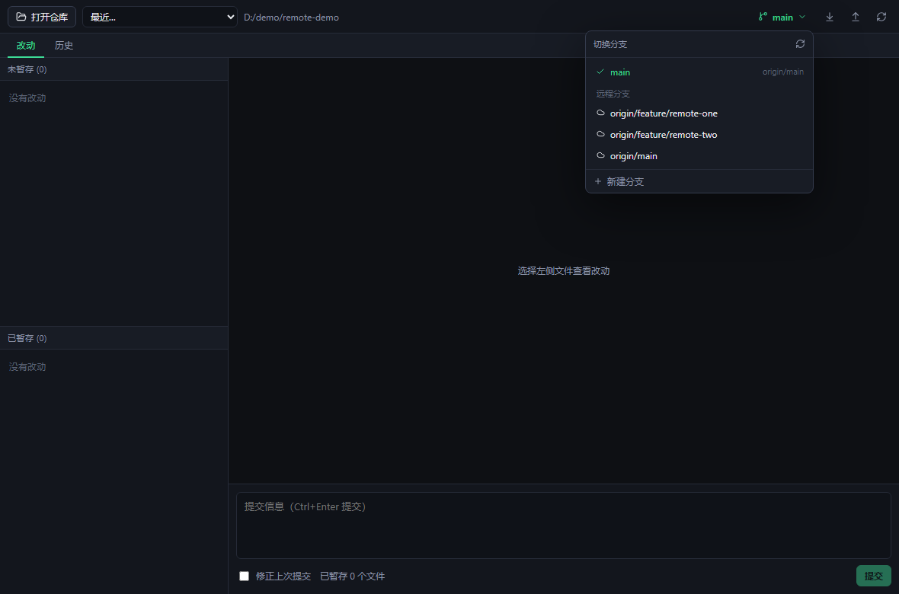

# 萤火虫 Firefly

<p align="center">
  
</p>

<p align="center">
  一个专注「看改动 → 暂存 → 提交」的本地 Git 客户端。免登录，日常操作全部在本机完成，
  只有你主动抓取 / 拉取 / 推送时才会联网。
</p>

<p align="center">
  <a href="https://github.com/kusanyao/firefly/releases"></a>
  
  
</p>

<p align="center">
  <a href="https://github.com/kusanyao/firefly/releases">下载</a> ·
  <a href="#从源码运行">从源码运行</a> ·
  <a href="#已知限制">已知限制</a>
</p>

---

## 界面







## 为什么做这个

SmartGit 之后没找到顺手的免费 Git 客户端：要么太重，要么把登录、云同步、AI 订阅塞进来。萤火虫只解决日常最高频的几件事，刻意不做的比做的多。

- **本地优先**：不登录，代码与配置只留在本机；只有你主动执行远程操作时才会联网，配置存在 `%APPDATA%\dev.firefly.app`
- **轻量**：Tauri 2 + 系统 WebView2，安装包只有几 MB
- **行为可预期**：所有操作直接调用本机 `git` 命令行，规则、钩子、`.gitattributes`、CRLF 都和你终端里完全一致

## 功能

### 改动与暂存

- 未暂存 / 已暂存两个列表，支持整文件、hunk、行三种粒度
- **行级暂存**：在 diff 里点选新增/删除行，`Ctrl` 多选、`Shift` 连选，只暂存选中的行
- 丢弃未暂存改动 / 删除未跟踪文件（均有二次确认）
- 提交与 `--amend`，`Ctrl+Enter` 快速提交
- 文件变化自动刷新（300ms 防抖），`F5` 手动刷新，`↑/↓` 切换文件

### 历史与分支

- 当前分支的 `git log --graph` 分支树：彩色 lane、合并/分叉连线
- 点击提交查看该次提交的文件列表与单文件 diff
- 分支切换、新建（`git switch -c`）、合并（`git merge`）、变基（`git rebase`）
- 远程分支：分支菜单里一键 `git fetch --all --prune`，抓取后点击远程分支即可检出为本地跟踪分支
- 分支搜索：菜单顶部输入关键字即可实时过滤本地和远程分支
- 遴选（cherry-pick）：分支菜单「遴选提交…」可从所有分支的近期提交中挑选，也可在历史页直接遴选选中提交；冲突时进入遴选状态，可中止
- 拉取 / 推送：顶栏按钮，针对当前分支的上游（`git pull --no-edit` / `git push`）；拉取冲突会进入「合并中」状态，可中止
- 工作区不干净时切换/合并会二次确认；合并/变基冲突进入对应状态，顶栏可中止

### 明确不做

冲突三方编辑、交互式 rebase（squash / reword / 重排）、强制推送、多远程管理。这些请交给终端或你现有的工具。

## 下载

前往 [Releases](https://github.com/kusanyao/firefly/releases)：

| 形式 | 说明 |
| --- | --- |
| `Firefly_*_x64-setup.exe` | NSIS 安装包，安装后出现在开始菜单 |
| `Firefly_*_portable_x64.zip` | 便携版，解压后直接运行 `firefly.exe` |

**环境要求**

- Windows 10 / 11 x64
- 已安装 [Git for Windows](https://git-scm.com/download/win)（2.23+），且 `git` 在 `PATH` 中
- WebView2 运行时（Windows 10/11 一般已自带）
- 抓取远程使用本机 Git 的凭据配置：HTTPS 会调用 Git Credential Manager，SSH 需要已配置好密钥

> 程序目前没有代码签名，SmartScreen 可能提示「未知发布者」，选择「仍要运行」即可。

## 从源码运行

```powershell
npm install
npm run tauri dev
```

> Windows 上请在 **PowerShell** 中执行 `cargo` / `npm run tauri` 命令。
> Git Bash 自带的 `link.exe` 可能干扰 MSVC 工具链。

构建安装包：

```powershell
npm run tauri build
```

产物在 `src-tauri/target/release/bundle/nsis/`。

测试：

```powershell
cd src-tauri
cargo test
```

环境要求：Node.js 18+、Rust MSVC 工具链（`rust-toolchain.toml` 已固定）、Visual Studio Build Tools 2022「使用 C++ 的桌面开发」。

`.cargo/config.toml` 配置了 rsproxy 镜像以加速国内下载；在海外可以删除该文件改用 crates.io。

## 技术实现

```
src-tauri/src/
  git/mod.rs      进程调用 + 输出解码（UTF-8 / GB18030 逐行兜底）
  git/status.rs   porcelain v2 解析
  git/diff.rs     diff 解析、单 hunk 补丁、按行补丁重建
  git/log.rs      提交历史 / 分支树 / 单提交文件列表
  git/branch.rs   分支切换、新建、合并、变基与远程操作（fetch / pull / push）
  git/ops.rs      stage / unstage / commit
  commands.rs     Tauri 命令
  watcher.rs      仓库文件监视
  storage.rs      最近仓库持久化
```

几个关键点：

- **不用 libgit2**，全部通过 `git` 命令行（plumbing 输出），结果和终端完全一致
- diff 解析保留**原始字节**，只在展示层解码，GBK 文件重建补丁才不会和 index 字节错位
- 行级暂存会重建一个合法补丁：补丁旧侧永远是当前 index，未选中的删除行转上下文、未选中的新增行丢弃；取消暂存是镜像逻辑
- 分支树的 lane 由 CSS 绘制（竖线贯穿整行、斜线连接相邻 lane 中心），不用字符画

## 已知限制

- 冲突文件不支持 diff 查看与编辑，只能整文件暂存（等同于 `git add` 标记为已解决）
- 未跟踪文件只支持整文件暂存，不能按行
- 超过 2 MB 的 diff 不渲染
- 没有语法高亮和字符级 diff
- 远程操作依赖本机 Git 凭据，不支持强制推送和 `pull --rebase`
- 仅测试了 Windows；Tauri 理论上可跨平台，但未验证

## 许可证

[MIT](LICENSE)
